<div align="center">


# 🚫 Sidebar Remover for All Websites

**Reclaim your screen space. Enjoy clean, distraction-free reading on any website.**

[](https://witrfaruk.github.io/Sidebar-Remover/)
[](#)
[](#)
[](#)

<br/>

<a href="https://witrfaruk.github.io/Sidebar-Remover/">
  
</a>

<p><em>▲ Watch sidebars &amp; scrollbars disappear automatically while content expands smoothly.</em></p>

</div>

---

### 🌐 Official Website &amp; Live Demo
👉 **[Visit the Live Website on GitHub Pages](https://witrfaruk.github.io/Sidebar-Remover/)** to try the interactive before/after simulation!

---

### ✨ Features at a Glance

| Feature | Description |
| :--- | :--- |
| ⚡ **Intelligent Auto-Detection** | Smart heuristics automatically detect sticky and fixed nav rails without touching core media or content. |
| 🛡️ **Zero Layout Breakage** | Expands the main reading container to 100% full width smoothly when sidebars are hidden. |
| 🚫 **Scrollbar Killer** | Suppresses vertical &amp; horizontal scrollbars while retaining full wheel, trackpad, and keyboard scrolling. |
| 🔒 **100% Local &amp; Private** | Runs purely in your browser. Zero tracking, zero telemetry, and zero remote network requests. |
| 🎛️ **Per-Site Controls** | Enable or disable per website with a single click in the popup, plus custom Allowlists &amp; Blocklists. |
| 🌓 **Charcoal Dark UI** | Sleek popup interface built with a curated dark color palette and custom micro-animations. |

---

### 🚀 Quick Installation

#### Method 1: Load in Developer Mode (Instant)
1. **Clone this repository**:
   ```bash
   git clone https://github.com/witrfaruk/Sidebar-Remover.git
   ```
2. Open Chrome and go to `chrome://extensions/`.
3. Enable **Developer mode** using the toggle in the top-right corner.
4. Click **Load unpacked** and select the `sidebar-remover` folder.
5. Pin **Sidebar Remover** to your Chrome toolbar!

---

### 🎯 How to Use

1. **Browse Any Website**: Visit your favorite blogs, documentation, news, or forums. Sidebars and scrollbars disappear automatically.
2. **Open the Popup**: Click the toolbar icon to see how many sidebars were hidden on the current page.
3. **Toggle Current Website**: Use the switch to pause or resume removal for specific domains.
4. **Restore Hidden**: Click **Restore Hidden** if you need the navigation back temporarily without refreshing.
5. **Settings Accordion**: Expand **More settings** to configure your Allowlist, Blocklist, or toggle scrollbar suppression.

---

### ⌨️ Architecture &amp; Tech Stack

- **Manifest V3**: Modern service worker and content script architecture.
- **Engine-Level CSS**: High-precedence scrollbar suppression injected before page render.
- **Dynamic Mutation Monitoring**: Seamlessly supports Single Page Applications (Next.js, React, Vue, Turbo).

---

<div align="center">

Made with ❤️ by [WitrFaruk](https://github.com/witrfaruk) • [Contact Developer](https://witrfaruk.vercel.app/contact)

[](https://witrfaruk.vercel.app/contact)
[](https://buymeacoffee.com/witrfaruk)
[](https://github.com/witrfaruk/Sidebar-Remover)

</div>
